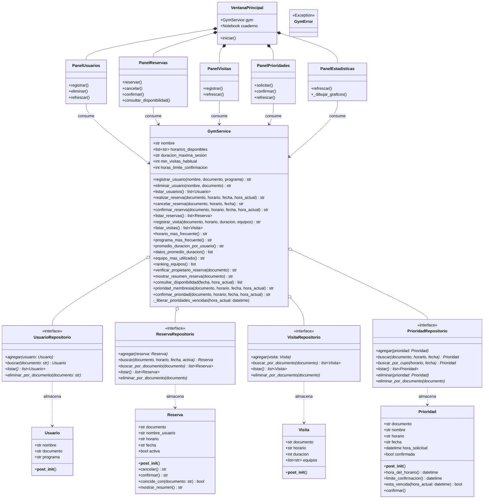

# Sistema de Gestión de Gimnasio Universitario
## Trabajo Práctico – Análisis, Diseño e Implementación Integral (Entrega 1 y Entrega 2)

**Institución:** Universidad de Medellín  
**Asignatura:** Programación Orientada a Objetos  
**Docente:** Mario Alejandro Saldarriaga Álvarez  
**Año:** 2026  

**Integrantes del Equipo:**
- **Juan José Aguirre Durango** (Módulo 2: Visitas, Calendario y Estadísticas Analíticas)
- **Angelina Negrette Diaz** (Módulo 3: Prioridades, Consultas y Diseño de Interfaz)
- **Samuel Zapata Trujillo** (Módulo 1: Usuarios, Reservas y Ensamblaje)

**Repositorio Oficial en GitHub:** [https://github.com/EntropyDip/gym_universitario.git](https://github.com/EntropyDip/gym_universitario.git)  
**Diagrama de Clases UML:** [https://drive.google.com/file/d/1gRu_CXmTEbWRui-bBbkF4v6x6d_zZPwD/view?usp=sharing](https://drive.google.com/file/d/1gRu_CXmTEbWRui-bBbkF4v6x6d_zZPwD/view?usp=sharing)

---

## 1. Descripción del Problema y Solución Propuesta

### 1.1 Contexto y Problemática Actual
En la actualidad, el proceso para separar un cupo en el gimnasio de la Universidad de Medellín se realiza de manera completamente manual mediante el envío de correos electrónicos a una cuenta administrativa. Esta dinámica genera una constante incertidumbre entre los estudiantes, quienes deben enviar su solicitud y esperar a que un funcionario revise la bandeja de entrada, verifique la agenda e informe la confirmación o el rechazo del espacio, lo que produce marcadas demoras en la respuesta y dificulta la planificación de sus rutinas diarias. Además, al no contar con un medio para consultar la disponibilidad de horarios en tiempo real, los usuarios se ven obligados a enviar mensajes a ciegas, derivando en un intercambio repetitivo de correos cuando la franja deseada ya se encuentra ocupada.

Esta dependencia del correo electrónico no solo afecta la experiencia del estudiante, sino que también genera un vacío crítico en la administración del gimnasio. La información sobre quiénes asisten a las instalaciones, la frecuencia de uso, los programas académicos a los que pertenecen, la duración de cada sesión y los equipos utilizados se queda dispersa e inestructurada dentro de la bandeja de entrada. Como consecuencia, la institución carece de un registro centralizado y de datos estadísticos que le permitan conocer los patrones reales de afluencia, identificar los horarios pico o evaluar el desgaste de las máquinas, dejando a los encargados sin herramientas analíticas para tomar decisiones informadas sobre la gestión y optimización del espacio.

### 1.2 Solución Propuesta
Para resolver esta problemática de forma integral, se diseñó e implementó una aplicación de escritorio desarrollada en **Python** bajo el paradigma de **Programación Orientada a Objetos**, con una **arquitectura por capas desacoplada** que asegura:
1. **Gestión centralizada de usuarios:** Registro validado por documento y eliminación transaccional en cascada de sus registros históricos.
2. **Sistema dinámico de reservas y consulta de disponibilidad:** Apartado de turnos en franjas continuas de **08:00 AM a 08:00 PM**, verificación en tiempo real de cupos (libres, reservados o apartados con código de colores) y control estricto de máximo una reserva activa diaria por estudiante.
3. **Control operativo de visitas y fidelización:** Registro de asistencias reales con duración en minutos y máquinas utilizadas, junto con un sistema de prioridad de membresía para usuarios habituales, respaldado por una ventana de caducidad automática de 2 horas.
4. **Módulo de analítica deportiva con gráficos en tiempo real:** Cálculo de horarios pico, programas académicos con mayor demanda, tiempo medio de permanencia por estudiante y ranking de desgaste de maquinaria deportiva, integrando gráficos interactivos con `matplotlib`.
5. **Robustez mediante manejo formal de excepciones:** Separación tajante entre la lógica de negocio y la interfaz gráfica (`tkinter`/`ttk`), asegurando que ningún error del usuario cierre la aplicación y que las validaciones no dependan de la vista.

---

## 2. Análisis del Problema

Siguiendo los lineamientos metodológicos de *J. Villalobos y R. Casallas*, los requisitos funcionales corresponden a operaciones puntuales que el sistema ofrece al usuario para modificar el estado del mundo o calcular valores. 

El resultado de cada operación se clasifica formalmente en tres tipos:
- **Tipo 1:** Modificación del estado del mundo del problema (creación, edición o eliminación de entidades).
- **Tipo 2:** Cálculo o consulta de un valor a partir del estado actual.
- **Tipo 3:** Mezcla de modificación del estado y cálculo de valores.

### 2.1 Requisitos Funcionales Detallados (R1 a R15)

---

#### R1. Registrar usuario
- **Identificador:** R1
- **Nombre:** Registrar usuario
- **Actor:** Administrador / Sistema
- **Resumen:** Registra un nuevo estudiante en el sistema, almacenando su nombre, número de documento y programa académico. Valida que el documento sea único y que ningún dato esté vacío.
- **Entradas:** `nombre` (Texto no vacío), `documento` (Texto no vacío), `programa` (Texto no vacío).
- **Resultado:** **Tipo 1 (Modificación).** Se crea y persiste una nueva entidad `Usuario`. Si el documento ya existe, lanza `UsuarioYaRegistradoError`. Si algún campo llega en blanco, lanza `DatoVacioError`.
- **Ejemplo de Uso / Salida en Consola:**
  ```text
  === REGISTRAR USUARIO ===
  Nombre: Mariana Restrepo
  Documento: 1004
  Programa: Administración de Empresas
  Salida: Usuario Mariana Restrepo registrado exitosamente.
  ```
- **Prototipo de Interfaz:** Pantalla P1 (Usuarios). Formulario con campos de texto y botón «Registrar». Al confirmar, la tabla de usuarios se actualiza en pantalla.

---

#### R2. Eliminar usuario en cascada *(Requisito Innovador de Samuel Zapata)*
- **Identificador:** R2
- **Nombre:** Eliminar usuario en cascada
- **Actor:** Administrador
- **Resumen:** Da de baja el registro de un usuario verificando la coincidencia exacta de nombre y documento, eliminando de forma inmediata y consistente todas sus reservas, visitas históricas y prioridades asociadas en el sistema.
- **Entradas:** `nombre` (Texto), `documento` (Texto).
- **Resultado:** **Tipo 1 (Modificación).** Elimina el usuario del repositorio y ejecuta una purga en cascada sobre los repositorios de reservas, visitas y prioridades. Si no hay coincidencia, lanza `UsuarioNoRegistradoError`.
- **Ejemplo de Uso / Salida en Consola:**
  ```text
  === ELIMINAR USUARIO ===
  Nombre: Mariana Restrepo
  Documento: 1004
  Salida: El usuario identificado con 1004 se eliminó correctamente.
  ```
- **Prototipo de Interfaz:** Pantalla P1 (Usuarios). Botón «Eliminar» con cuadro de diálogo emergente de confirmación: *«¿Eliminar al usuario con todas sus reservas, visitas y prioridades?»*.

---

#### R3. Realizar reserva
- **Identificador:** R3
- **Nombre:** Realizar reserva
- **Actor:** Estudiante / Sistema
- **Resumen:** Aparta un cupo para un horario y fecha específicos, validando que el estudiante esté registrado, que el horario pertenezca a la franja operativa (08:00 AM a 08:00 PM), que la fecha sea válida en el calendario, que el cupo no esté apartado con prioridad por otro usuario y que el estudiante no tenga otra reserva activa ese día.
- **Entradas:** `documento` (Texto), `horario_deseado` (Texto en agenda), `fecha` (Texto AAAA-MM-DD), `hora_actual` (datetime opcional).
- **Resultado:** **Tipo 1 (Modificación).** Registra una entidad `Reserva` en estado activa. Si viola alguna regla, lanza la excepción correspondiente (`UsuarioNoRegistradoError`, `FechaInvalidaError`, `HorarioInvalidoError`, `CupoApartadoError`, `ReservaDuplicadaError`).
- **Ejemplo de Uso / Salida en Consola:**
  ```text
  === REALIZAR RESERVA ===
  Documento: 1004 | Horario: 08:00 AM | Fecha: 2026-11-10
  Salida: ¡Reserva exitosa! Mariana Restrepo tiene su espacio a las 08:00 AM. El tiempo para estar haciendo uso del gym es: 1:30 horas.
  ```
- **Prototipo de Interfaz:** Pantalla P2 (Reservas). Formulario con selector de fecha `DateEntry`, lista desplegable de horarios de 08:00 AM a 08:00 PM y botón «Reservar».

---

#### R4. Registrar visita al gimnasio
- **Identificador:** R4
- **Nombre:** Registrar visita
- **Actor:** Encargado del Gimnasio
- **Resumen:** Registra el acceso real de un estudiante a las instalaciones, guardando el horario de ingreso, la duración en minutos de la sesión y las máquinas o equipos utilizados.
- **Entradas:** `documento` (Texto), `horario` (Texto disponible), `duracion` (Entero positivo > 0), `equipos` (Lista de cadenas de texto).
- **Resultado:** **Tipo 1 (Modificación).** Almacena una entidad `Visita`. Valida usuario registrado (`UsuarioNoRegistradoError`), horario disponible (`HorarioInvalidoError`) y duración entera positiva excluyendo booleanos (`DuracionInvalidaError`).
- **Ejemplo de Uso / Salida en Consola:**
  ```text
  === REGISTRAR VISITA ===
  Documento: 1004 | Horario: 08:00 AM | Duración: 60 | Equipos: Mancuernas, Cinta de correr
  Salida: Visita de Mariana Restrepo registrada correctamente.
  ```
- **Prototipo de Interfaz:** Pantalla P3 (Visitas). Formulario con checkboxes para equipos comunes, campo para otros equipos y tabla histórica de asistencias.

---

#### R5. Consultar horario más frecuente
- **Identificador:** R5
- **Nombre:** Consultar horario más frecuente
- **Actor:** Encargado / Sistema
- **Resumen:** Analiza el historial acumulado de visitas y determina la franja horaria que registra la mayor cantidad de asistencias efectivas.
- **Entradas:** Ninguna (consulta sobre las visitas registradas).
- **Resultado:** **Tipo 2 (Cálculo).** Cadena con el horario pico. Si no hay visitas registradas, retorna *«No hay visitas registradas.»*.
- **Ejemplo de Uso / Salida en Consola:**
  ```text
  === HORARIO MÁS FRECUENTE ===
  Salida: El horario más frecuente es 08:00 AM.
  ```
- **Prototipo de Interfaz:** Pantalla P5 (Estadísticas). Tarjeta destacada de KPI en la cabecera superior.

---

#### R6. Consultar programa académico más frecuente
- **Identificador:** R6
- **Nombre:** Consultar programa académico más frecuente
- **Actor:** Encargado / Directivos
- **Resumen:** Identifica la carrera universitaria con el mayor número de estudiantes inscritos en el gimnasio.
- **Entradas:** Ninguna (consulta sobre la colección de usuarios).
- **Resultado:** **Tipo 2 (Cálculo).** Cadena con el nombre del programa académico con mayor representatividad. Si no hay usuarios, informa que no hay registros.
- **Ejemplo de Uso / Salida en Consola:**
  ```text
  === PROGRAMA MÁS FRECUENTE ===
  Salida: La carrera más frecuente es Administración de Empresas.
  ```
- **Prototipo de Interfaz:** Pantalla P5 (Estadísticas). Indicador textual en la cabecera del panel de métricas.

---

#### R7. Cancelar reserva
- **Identificador:** R7
- **Nombre:** Cancelar reserva
- **Actor:** Estudiante / Sistema
- **Resumen:** Cambia el estado de una reserva activa a cancelada para liberar disponibilidad. Si ya estaba cancelada, notifica al usuario sin provocar errores.
- **Entradas:** `documento` (Texto), `horario` (Texto), `fecha` (Texto).
- **Resultado:** **Tipo 1 (Modificación).** La reserva pasa a `activa = False`. Si no existe ninguna reserva con esos parámetros, lanza `ReservaNoEncontradaError`.
- **Ejemplo de Uso / Salida en Consola:**
  ```text
  === CANCELAR RESERVA ===
  Documento: 1004 | Horario: 08:00 AM | Fecha: 2026-11-10
  Salida: Reserva de Mariana Restrepo a las 08:00 AM cancelada.
  ```
- **Prototipo de Interfaz:** Pantalla P2 (Reservas). Botón «Cancelar» que actualiza la tabla de reservas cambiando el estado a *«cancelada»*.

---

#### R8. Confirmar / Reactivar reserva *(Requisito Innovador de Samuel Zapata)*
- **Identificador:** R8
- **Nombre:** Confirmar reserva
- **Actor:** Estudiante / Sistema
- **Resumen:** Reactiva una reserva previamente cancelada, validando que el cupo no haya sido tomado por una prioridad de otro estudiante ni genere conflicto de dos reservas activas el mismo día.
- **Entradas:** `documento` (Texto), `horario` (Texto), `fecha` (Texto), `hora_actual` (Opcional).
- **Resultado:** **Tipo 1 (Modificación).** La reserva pasa a `activa = True`. Lanza `CupoApartadoError` si el cupo fue tomado o `ReservaDuplicadaError` si ya cuenta con otra reserva activa ese día.
- **Ejemplo de Uso / Salida en Consola:**
  ```text
  === CONFIRMAR RESERVA ===
  Documento: 1004 | Horario: 08:00 AM | Fecha: 2026-11-10
  Salida: Reserva de Mariana Restrepo confirmada nuevamente para las 08:00 AM.
  ```
- **Prototipo de Interfaz:** Pantalla P2 (Reservas). Botón «Confirmar».

---

#### R9. Verificar titularidad de reserva
- **Identificador:** R9
- **Nombre:** Verificar propietario de reserva
- **Actor:** Sistema / Usuario
- **Resumen:** Consulta rápidamente si un número de documento posee alguna reserva registrada (activa o histórica) en el gimnasio.
- **Entradas:** `documento` (Texto).
- **Resultado:** **Tipo 2 (Cálculo).** Devuelve la cadena *«Sí»* si existe al menos una reserva coincidente, o *«No»* en caso contrario.
- **Ejemplo de Uso / Salida en Consola:**
  ```text
  === COMPROBAR RESERVA ===
  Documento: 1004
  Salida: ¿La reserva pertenece al usuario?: Sí.
  ```
- **Prototipo de Interfaz:** Pantalla P2 (Reservas). Botón «¿Es del usuario?» que muestra el resultado en una etiqueta informativa.

---

#### R10. Mostrar resumen de reserva
- **Identificador:** R10
- **Nombre:** Mostrar resumen de reserva
- **Actor:** Estudiante / Encargado
- **Resumen:** Genera una descripción legible y resumida de la reserva más relevante del estudiante (nombre, documento, fecha, horario y estado activa/cancelada).
- **Entradas:** `documento` (Texto).
- **Resultado:** **Tipo 2 (Cálculo).** Cadena formateada descriptiva. Si el usuario no posee reservas, lanza `ReservaNoEncontradaError`.
- **Ejemplo de Uso / Salida en Consola:**
  ```text
  === RESUMEN DE RESERVA ===
  Documento: 1004
  Salida: Reserva (activa) — Mariana Restrepo (1004), 2026-11-10, 08:00 AM.
  ```
- **Prototipo de Interfaz:** Pantalla P2 (Reservas). Botón «Ver resumen» que expone los detalles en una barra de estado textual.

---

#### R11. Consultar promedio de duración por usuario *(Requisito Innovador de Juan José Aguirre)*
- **Identificador:** R11
- **Nombre:** Consultar promedio de duración por usuario
- **Actor:** Encargado / Analista
- **Resumen:** Calcula la media aritmética de tiempo en minutos por usuario a partir de sus visitas registradas, con precisión de un decimal, y genera las estructuras numéricas para el gráfico de barras.
- **Entradas:** Ninguna (consulta sobre la colección de visitas).
- **Resultado:** **Tipo 2 (Cálculo).** Texto consolidado con el promedio de cada usuario y lista de tuplas `(nombre_usuario, promedio_minutos)` ordenada descendentemente.
- **Ejemplo de Uso / Salida en Consola:**
  ```text
  === PROMEDIO DE DURACIÓN POR USUARIO ===
  Promedio de duración por usuario:
  - Mariana Restrepo (1004): 70.0 minutos en promedio
  - Diego Vega (1005): 45.0 minutos en promedio
  ```
- **Prototipo de Interfaz:** Pantalla P5 (Estadísticas). Renderizado visual en gráfico de barras mediante `matplotlib`.

---

#### R12. Solicitar prioridad de membresía *(Requisito Innovador de Angelina Negrette)*
- **Identificador:** R12
- **Nombre:** Solicitar prioridad de membresía
- **Actor:** Estudiante Habitual
- **Resumen:** Permite apartar con exclusividad un cupo futuro en un horario y fecha determinados si el usuario es "habitual" (acumula ≥3 visitas registradas a esa misma hora) o si registra estrictamente mayor tiempo total de entrenamiento que cualquier otro usuario (sin empates).
- **Entradas:** `documento` (Texto), `horario` (Texto), `fecha` (Texto AAAA-MM-DD), `hora_actual` (datetime inyectable).
- **Resultado:** **Tipo 1 (Modificación).** Crea un cupo exclusivo en la entidad `Prioridad`. Si faltan menos de 2 horas para la sesión o no cumple los criterios de fidelidad, lanza `PrioridadNoCumpleError`. Si ya está apartado por otro, lanza `CupoApartadoError`.
- **Ejemplo de Uso / Salida en Consola:**
  ```text
  === SOLICITAR PRIORIDAD ===
  Documento: 1004 | Horario: 08:00 AM | Fecha: 2026-11-20
  Salida: Mariana Restrepo obtuvo prioridad para el horario 08:00 AM del 2026-11-20. Tiene hasta 2 horas antes para confirmar asistencia.
  ```
- **Prototipo de Interfaz:** Pantalla P4 (Prioridades). Botón «Solicitar Prioridad» y tabla con indicador de límite de confirmación.

---

#### R13. Confirmar prioridad de membresía *(Requisito Innovador de Angelina Negrette)*
- **Identificador:** R13
- **Nombre:** Confirmar prioridad de membresía
- **Actor:** Estudiante con Prioridad / Sistema
- **Resumen:** Ratifica la asistencia al cupo apartado. Si la confirmación ocurre con 2 o más horas de antelación respecto al horario, el cupo queda asegurado; si se intenta confirmar con menos de 2 horas, el cupo caduca y se libera automáticamente para la comunidad.
- **Entradas:** `documento` (Texto), `horario` (Texto), `fecha` (Texto), `hora_actual` (datetime inyectable).
- **Resultado:** **Tipo 3 (Mezcla).** Si `hora_actual <= limite`: confirma el cupo (`confirmada = True`). Si `hora_actual > limite`: elimina la prioridad y libera el horario. Si la prioridad no existe, lanza `PrioridadNoEncontradaError`.
- **Ejemplo de Uso / Salida en Consola:**
  ```text
  === CONFIRMAR PRIORIDAD ===
  Documento: 1004 | Horario: 08:00 AM | Fecha: 2026-11-20
  Salida: Mariana Restrepo confirmó su asistencia. El cupo de las 08:00 AM del 2026-11-20 es exclusivo.
  ```
- **Prototipo de Interfaz:** Pantalla P4 (Prioridades). Botón «Confirmar Asistencia» y actualización del estado de la tabla a *«Confirmada»*.

---

#### R14. Consultar disponibilidad de horarios
- **Identificador:** R14
- **Nombre:** Consultar disponibilidad de horarios
- **Actor:** Estudiante / Recepción
- **Resumen:** Consulta en tiempo real el estado de todos los horarios de la jornada (08:00 AM a 08:00 PM) para una fecha específica, indicando si cada franja está libre, reservada o apartada con prioridad (y por quién).
- **Entradas:** `fecha` (Texto AAAA-MM-DD), `hora_actual` (Opcional).
- **Resultado:** **Tipo 2 (Cálculo).** Lista de tuplas `(horario, estado, detalle)` donde `estado` es `"libre"` (verde), `"reservado"` (amarillo) o `"apartado"` (rojo claro).
- **Ejemplo de Uso / Salida en Consola:**
  ```text
  === DISPONIBILIDAD (2026-11-20) ===
  - [08:00 AM] APARTADO: Apartado (confirmada) por Mariana Restrepo (1004)
  - [10:00 AM] LIBRE: Cupo disponible
  - [12:00 PM] LIBRE: Cupo disponible
  - [02:00 PM] RESERVADO: Reservado por Diego Vega (1005)
  - [04:00 PM] LIBRE: Cupo disponible
  - [06:00 PM] LIBRE: Cupo disponible
  - [08:00 PM] LIBRE: Cupo disponible
  ```
- **Prototipo de Interfaz:** Pantalla P2 (Reservas). Tabla de disponibilidad coloreada dinámicamente según el estado del cupo.

---

#### R15. Consultar equipo más utilizado *(Requisito Innovador de Juan José Aguirre)*
- **Identificador:** R15
- **Nombre:** Consultar equipo más utilizado
- **Actor:** Administrador / Mantenimiento
- **Resumen:** Cuantifica la frecuencia de uso de cada máquina o equipo deportivo a partir de los registros de visitas (contando máximo una vez por visita y normalizando mayúsculas/minúsculas) y genera el ranking analítico de utilización.
- **Entradas:** Ninguna (consulta sobre las visitas registradas).
- **Resultado:** **Tipo 2 (Cálculo).** Identifica el equipo con mayor demanda acumulada y devuelve la lista de tuplas `(equipo, número_de_usos)` ordenada descendentemente.
- **Ejemplo de Uso / Salida en Consola:**
  ```text
  === EQUIPO MÁS UTILIZADO ===
  Salida: El equipo más utilizado es Mancuernas con 3 usos registrados.
  Ranking completo: [('Mancuernas', 3), ('Cinta De Correr', 2), ('Poleas', 1)]
  ```
- **Prototipo de Interfaz:** Pantalla P5 (Estadísticas). Renderizado visual del segundo gráfico de barras con `matplotlib`.

---

### 2.2 Resumen de Prototipos de Pantalla (P1 a P5)

La interfaz gráfica desarrollada en `tkinter`/`ttk` se organiza a través de un contenedor principal con pestañas (`ttk.Notebook`):

| Pantalla | Requisitos Atendidos | Componentes Visuales Principales |
|---|---|---|
| **P1. Usuarios** | R1, R2 | Formulario de alta (nombre, documento, programa académico), botones «Registrar» y «Eliminar», y tabla interactiva con scroll vertical de usuarios registrados. |
| **P2. Reservas** | R3, R7, R8, R9, R10, R14 | Selector de documento, selector visual de fecha `tkcalendar`, lista desplegable de horarios (08:00 AM a 08:00 PM), tabla coloreada de disponibilidad y tabla general de reservas. |
| **P3. Visitas** | R4 | Selector de documento y horario, campo de duración en minutos, panel de selección de equipos comunes (checkboxes), entrada para otros equipos y tabla de visitas. |
| **P4. Prioridades** | R12, R13 | Selectores de documento, fecha y horario, botones «Solicitar Prioridad» y «Confirmar Asistencia», y tabla de cupos prioritarios con límite exacto de confirmación. |
| **P5. Estadísticas** | R5, R6, R11, R15 | Tarjetas superiores con indicadores de horario pico, programa más frecuente y máquina top, junto con dos gráficos de barras analíticos embebidos mediante `FigureCanvasTkAgg`. |

```
+------------------------------------------------------------------------------------------+
|  🏋️ GIMNASIO UNIVERSITARIO       Sesión máxima: 1:30 horas | Horarios: 08:00 AM a 08:00 PM |
+------------------------------------------------------------------------------------------+
| [ 👤 Usuarios ] [ 📅 Reservas ] [ ⏱️ Visitas ] [ ⭐ Prioridades ] [ 📊 Estadísticas ]      |
+------------------------------------------------------------------------------------------+
|  (Contenido dinámico según la pestaña activa - Las tablas inician limpias y se pueblan   |
|   exclusivamente a medida que el usuario interactúa y registra datos en la aplicación)   |
+------------------------------------------------------------------------------------------+
```

---

### 2.3 Requisitos No Funcionales y Restricciones Técnicas

1. **Plataforma y Versión de Lenguaje:** Desarrollado íntegramente en Python 3.10 o superior (compatible con Python 3.12 y 3.13), garantizando portabilidad multiplataforma.
2. **Persistencia en Memoria:** Los datos se mantienen en memoria durante la ejecución de la aplicación mediante estructuras de datos desacopladas (repositorios), sin requerir motores de bases de datos externas para esta versión.
3. **Formatos Estrictos:** Las fechas deben expresarse en formato internacional `AAAA-MM-DD` y los horarios en formato de 12 horas `hh:mm AM/PM`.
4. **Validación de Calendario Real:** La validación de fechas no es una simple comprobación de texto; el algoritmo matemático verifica días por mes (30, 31, 28) y ajusta febrero a 29 días evaluando si el año es bisiesto según la regla gregoriana (`anio % 4 == 0 and (anio % 100 != 0 or anio % 400 == 0)`).
5. **Comportamiento Inicial de Interfaz:** La aplicación arranca sin datos simulados o mock precargados en pantalla por defecto; las tablas se muestran limpias y se alimentan de forma reactiva a medida que el usuario efectúa registros.
6. **Robustez ante Errores:** Cualquier dato inválido, choque de reserva o cupo apartado lanza una excepción de dominio que es interceptada por la interfaz gráfica, mostrando un cuadro de diálogo informativo (`messagebox.showerror`) sin abortar el proceso.
7. **Librerías Externas Declaradas:** Se hace uso de `matplotlib` para la generación de gráficos estadísticos y `tkcalendar` para la selección interactiva de fechas, ambas especificadas en [requirements.txt](file:///c:/Users/Samuel/gym_universitario/requirements.txt).

---

### 2.4 Modelo del Mundo del Problema (Dominio)

#### Entidades del Dominio
- **`Usuario`:** Modela al estudiante universitario que hace uso del gimnasio.
- **`Reserva`:** Modela el apartado formal de un cupo en una fecha y horario.
- **`Visita`:** Registra la presencia real, tiempo de uso y máquinas empleadas.
- **`Prioridad`:** Representa un cupo preferencial otorgado a estudiantes habituales con una ventana de caducidad obligatoria.
- **`Gym` / `GymService`:** Entidad central que administra el catálogo de horarios y orquesta las reglas de negocio entre los colaboradores.

#### Tabla de Atributos, Tipos y Valores Permitidos

| Entidad | Atributo | Tipo de Dato | Restricción / Valores Permitidos |
|---|---|---|---|
| **Usuario** | `nombre` | `str` | Cadena de texto no vacía (aplica `strip`). |
| | `documento` | `str` | Identificador único del estudiante en el gimnasio. |
| | `programa` | `str` | Carrera o programa académico no vacío. |
| **Reserva** | `documento` | `str` | Debe corresponder a un usuario previamente registrado. |
| | `nombre_usuario` | `str` | Nombre del titular al momento de reservar. |
| | `horario` | `str` | Franja horaria válida dentro del catálogo operativo. |
| | `fecha` | `str` | Cadena AAAA-MM-DD matemáticamente válida en el calendario. |
| | `activa` | `bool` | `True` si la reserva está vigente, `False` si fue cancelada. |
| **Visita** | `documento` | `str` | Documento de usuario registrado. |
| | `horario` | `str` | Franja horaria de la visita. |
| | `duracion` | `int` | Entero positivo estrictamente mayor a 0 minutos. |
| | `equipos` | `list[str]` | Lista de máquinas y accesorios utilizados (limpia de vacíos). |
| **Prioridad** | `documento` | `str` | Documento del usuario con membresía preferencial. |
| | `nombre` | `str` | Nombre del beneficiario de la prioridad. |
| | `horario`, `fecha` | `str`, `str` | Horario disponible y fecha válida de la reserva prioritaria. |
| | `hora_solicitud` | `datetime` | Marca de tiempo exacta del momento de la solicitud. |
| | `confirmada` | `bool` | `True` si ya ratificó asistencia, `False` si está pendiente. |
| **GymService** | `nombre` | `str` | "Gimnasio universitario". |
| | `horarios_disponibles` | `list[str]` | `["08:00 AM", "10:00 AM", "12:00 PM", "02:00 PM", "04:00 PM", "06:00 PM", "08:00 PM"]`. |
| | `duracion_maxima_sesion` | `str` | "1:30 horas". |

#### Relaciones y Asociaciones del Modelo Conceptual

| Origen | Asociación | Destino | Multiplicidad | Descripción |
|---|---|---|---|---|
| **GymService** | `usuarios` | `Usuario` | $1 \longrightarrow 0..*$ | Administra el catálogo de usuarios registrados. |
| **GymService** | `reservas` | `Reserva` | $1 \longrightarrow 0..*$ | Administra las reservas activas y canceladas. |
| **GymService** | `visitas` | `Visita` | $1 \longrightarrow 0..*$ | Administra el historial de asistencias efectivas. |
| **GymService** | `prioridades`| `Prioridad` | $1 \longrightarrow 0..*$ | Administra los cupos preferenciales otorgados. |
| **Reserva** | `titular` | `Usuario` | $* \longrightarrow 1$ | Asociada a un usuario por número de documento. |
| **Visita** | `asistente` | `Usuario` | $* \longrightarrow 1$ | Asociada a un usuario por número de documento. |
| **Prioridad** | `beneficiario`| `Usuario` | $* \longrightarrow 1$ | Asociada a un usuario por número de documento. |

#### Reglas de Negocio del Dominio (RN1 a RN10)
- **RN1 (Unicidad de Documento):** No se permite registrar dos usuarios con el mismo número de documento.
- **RN2 (Franjas Oficiales):** Los únicos horarios disponibles para reservas y visitas son: `08:00 AM`, `10:00 AM`, `12:00 PM`, `02:00 PM`, `04:00 PM`, `06:00 PM` y `08:00 PM`.
- **RN3 (Límite Diario de Reservas):** Un estudiante puede tener múltiples reservas en distintas fechas, pero solo puede tener **una reserva activa por fecha**.
- **RN4 (Tiempo Máximo de Sesión):** Cada franja autoriza un tiempo máximo de permanencia de **1:30 horas**.
- **RN5 (Criterios de Prioridad):** Se otorga prioridad sobre un horario a quien sea usuario habitual (≥3 visitas registradas a esa misma hora, sin importar la fecha) o quien acumule estrictamente más minutos totales de uso que cualquier otro usuario (en caso de empate, el criterio de tiempo se anula).
- **RN6 (Ventana de Caducidad de Prioridad):** El cupo apartado con prioridad debe confirmarse con al menos **2 horas de antelación** al inicio de la sesión. Si no se confirma a tiempo, el cupo caduca y se libera automáticamente.
- **RN7 (Exclusividad de Prioridad):** Un cupo apartado con prioridad vigente es exclusivo: ningún otro usuario puede reservarlo ni solicitar prioridad sobre él.
- **RN8 (Calendario Gregoriano Estricto):** Las fechas deben ingresar en formato `AAAA-MM-DD` y existir matemáticamente en el calendario, contemplando bisiestos.
- **RN9 (Eliminación en Cascada):** La eliminación de un usuario remueve automáticamente todas sus reservas, visitas y prioridades asociadas.
- **RN10 (Sesión Positiva):** Toda visita debe registrar una duración mayor a 0 minutos.

---

## 3. Diseño de la Solución (Entrega 2)

### 3.1 Descomposición de Requisitos en Métodos y Subtareas

| Requisito | Clase / Método | Subtareas y Lógica Técnica |
|---|---|---|
| **R1** | `GymService.registrar_usuario` | Verifica no existencia del documento; instancia `Usuario` (valida textos no vacíos); persiste en `UsuarioRepositorio.agregar`. |
| **R2** | `GymService.eliminar_usuario` | Valida coincidencia de nombre y documento; llama a `eliminar_por_documento` en repositorios de reservas, visitas y prioridades; elimina de usuarios. |
| **R3** | `GymService.realizar_reserva` | Valida usuario; valida fecha y bisiestos; purga prioridades vencidas; valida horario oficial; valida que no esté apartado con prioridad ajena; verifica ausencia de reserva activa en esa fecha; crea y almacena `Reserva`. |
| **R4** | `GymService.registrar_visita` | Valida usuario; valida horario; instancia `Visita` (valida duración > 0 y limpia lista de máquinas); almacena en `VisitaRepositorio.agregar`. |
| **R5** | `GymService.horario_mas_frecuente` | Itera sobre visitas, totaliza frecuencia por franja horaria y retorna la moda estadística. |
| **R6** | `GymService.programa_mas_frecuente` | Itera sobre usuarios, totaliza por programa académico y determina la carrera con mayor cantidad de inscritos. |
| **R7** | `GymService.cancelar_reserva` | Localiza la reserva por documento, horario y fecha (priorizando la activa); invoca `Reserva.cancelar()`. |
| **R8** | `GymService.confirmar_reserva` | Localiza la reserva cancelada; purga prioridades vencidas; verifica exclusividad y ausencia de otra reserva activa en la fecha; invoca `Reserva.confirmar()`. |
| **R9** | `GymService.verificar_propietario_reserva` | Examina la colección de reservas y retorna "Sí" si existe coincidencia de titularidad, o "No". |
| **R10** | `GymService.mostrar_resumen_reserva` | Obtiene las reservas del documento; selecciona la más reciente/activa e invoca `Reserva.mostrar_resumen()`. Si no hay reservas, lanza excepción. |
| **R11** | `GymService.promedio_duracion_por_usuario` | Agrupa minutos y cantidad de asistencias por documento; calcula media con un decimal; estructura tuplas para interfaz y gráficos. |
| **R12** | `GymService.prioridad_membresia` | Valida antelación (mínimo 2 horas antes de la sesión); evalúa condición de habitual (≥3 visitas en el horario) o mayor tiempo acumulado estricto; crea y guarda `Prioridad`. |
| **R13** | `GymService.confirmar_prioridad` | Localiza prioridad; evalúa si `hora_actual > limite_confirmacion()`; si venció, la elimina y libera el cupo; si está a tiempo, marca `confirmada = True`. |
| **R14** | `GymService.consultar_disponibilidad` | Para cada horario oficial en la fecha dada: verifica prioridades vigentes (apartado) o reservas activas (reservado), o reporta libre. |
| **R15** | `GymService.equipo_mas_utilizado` | Cuantifica apariciones de cada equipo en visitas (normalizando texto) y genera el ranking ordenado descendentemente. |

---

### 3.2 Diagrama de Clases UML v2 (Arquitectura Completa)



---

### 3.3 Organización Modular del Código

```text
gym_universitario/
│
├── main.py                     # Punto de entrada, inyección de dependencias y CLI
├── excepciones.py              # Jerarquía de errores de dominio (GymError)
├── modelos.py                  # Dataclasses (Usuario, Reserva, Visita, Prioridad) y fechas
├── repositorios.py             # Interfaces abstractas (ABC) e implementaciones en memoria
├── servicios.py                # GymService: Orquestador de reglas de negocio R1 a R15
├── test_gym.py                 # 29 pruebas unitarias automatizadas con unittest
├── requirements.txt            # Dependencias externas (matplotlib, tkcalendar)
├── README.md                   # Resumen del proyecto e instrucciones
├── responsabilidades.md        # Matriz original de trabajo y sustentación
├── documento_analisis_diseno.md# Documento maestro consolidado de Entrega 1 y 2
│
└── interfaz/                   # Capa de presentación desacoplada (Tkinter/ttk)
    ├── __init__.py             # Paquete Python
    ├── componentes.py          # PanelBase, TablaDatos, SelectorFecha, SelectorHorario
    ├── ventana_principal.py    # Ventana raíz contenedora con ttk.Notebook
    ├── panel_usuarios.py       # Pantalla P1: Usuarios (R1, R2)
    ├── panel_reservas.py       # Pantalla P2: Reservas y Disponibilidad (R3, R7, R8, R9, R10, R14)
    ├── panel_visitas.py        # Pantalla P3: Asistencia y Equipos (R4)
    ├── panel_prioridades.py    # Pantalla P4: Fidelización y Caducidad (R12, R13)
    └── panel_estadisticas.py   # Pantalla P5: Métricas y Gráficos Matplotlib (R5, R6, R11, R15)
```

---

### 3.4 Matriz de Manejo de Excepciones

| Situación Anómala / Regla Violada | Excepción Lanzada | Manejo en la Interfaz Gráfica |
|---|---|---|
| Documento ya registrado en el sistema (R1) | `UsuarioYaRegistradoError` | `messagebox.showerror("Error de negocio", mensaje)` |
| Documento inexistente o nombre que no coincide (R2, R3, R4, R12) | `UsuarioNoRegistradoError` | Notificación en diálogo emergente sin cerrar la ventana |
| Campo obligatorio vacío o solo espacios en blanco | `DatoVacioError` | Notificación al usuario indicando el campo faltante |
| Duración menor o igual a 0 o no numérica (R4) | `DuracionInvalidaError` | Alerta indicando que la duración debe ser entera positiva |
| Horario fuera de la franja oficial (R3, R4, R12) | `HorarioInvalidoError` | Muestra lista de horarios disponibles permitidos |
| Fecha inexistente o año no bisiesto (R3, R12, R14) | `FechaInvalidaError` | Notificación de formato estricto AAAA-MM-DD |
| Segunda reserva activa el mismo día para un usuario (R3, R8) | `ReservaDuplicadaError` | Alerta de límite de una reserva diaria |
| Cupo apartado con prioridad por otro usuario (R3, R8, R12) | `CupoApartadoError` | Alerta informando el titular de la prioridad |
| No cumple visitas habituales ni mayor tiempo acumulado (R12) | `PrioridadNoCumpleError` | Explicación detallada de los requisitos de fidelidad |
| Reserva no encontrada para cancelar, confirmar o resumir (R7, R8, R10) | `ReservaNoEncontradaError` | Mensaje de inexistencia de la reserva |
| Prioridad no encontrada para confirmar o ratificar (R13) | `PrioridadNoEncontradaError`| Mensaje de inexistencia de la solicitud |

---

## 4. Implementación y Cumplimiento de Restricciones

### 4.1 Distribución Equitativa del Trabajo (18 Puntos por Integrante)

| Integrante | Módulo | Puntos | Historias de Usuario | Requisitos Asignados |
|---|---|:---:|---|---|
| **Samuel Zapata Trujillo** | Módulo 1: Usuarios, Reservas y Ensamblaje | 18 | HU-01, HU-02, HU-03 | R1, R2, R3, R7, R8 |
| **Juan José Aguirre Durango** | Módulo 2: Visitas, Calendario y Estadísticas | 18 | HU-04, HU-05, HU-06 | R4, R5, R6, R11, R15 |
| **Angelina Negrette Diaz** | Módulo 3: Prioridades, Consultas y Diseño | 18 | HU-07, HU-08, HU-09 | R9, R10, R12, R13, R14 |

### 4.2 Requisitos Funcionales Innovadores / "Interesantes"
1. **Samuel Zapata Trujillo (R8 & R2):** Mecanismo de reactivación concurrente de reservas con validación de exclusividad de cupo frente a prioridades ajenas, y motor de eliminación transaccional en cascada que purga de forma atómica reservas, visitas y prioridades del usuario.
2. **Juan José Aguirre Durango (R11 & R15):** Motor analítico de agregación estadística sobre duración de permanencia y ranking de desgaste de equipamiento con normalización textual y renderizado gráfico interactivo en tiempo real mediante `matplotlib`.
3. **Angelina Negrette Diaz (R12 & R13):** Sistema dinámico de prioridad de membresía basado en fidelidad habitual (≥3 visitas) y desempate estricto por tiempo acumulado, respaldado por una ventana de caducidad automática de 2 horas previas a la sesión.

### 4.3 Comportamiento de Pantalla: Carga Reactiva sin Datos Mock por Defecto
En cumplimiento con las directrices de la entrega:
- Al ejecutar `python main.py`, la aplicación inicia con las colecciones **completamente vacías**.
- La tabla de usuarios, las reservas, las visitas y las prioridades se muestran inicialmente limpias y se alimentan de forma estrictamente reactiva a medida que el usuario interactúa con los formularios y confirma acciones.
- Se mantiene el comando opcional `python main.py --demo` exclusivamente para demostraciones académicas guiadas.

---

## 5. Plan y Evidencia de Verificación

### 5.1 Suite Completa de 29 Pruebas Unitarias Automatizadas
Se diseñó e implementó en [test_gym.py](file:///c:/Users/Samuel/gym_universitario/test_gym.py) un conjunto exhaustivo de pruebas unitarias con `unittest`:

```text
test_consultar_disponibilidad (test_gym.TestConsultasYDisponibilidad.test_consultar_disponibilidad) ... ok
test_mostrar_resumen_reserva (test_gym.TestConsultasYDisponibilidad.test_mostrar_resumen_reserva) ... ok
test_verificar_propietario (test_gym.TestConsultasYDisponibilidad.test_verificar_propietario) ... ok
test_estadisticas_sin_datos (test_gym.TestEstadisticas.test_estadisticas_sin_datos) ... ok
test_metricas_completas_visitas (test_gym.TestEstadisticas.test_metricas_completas_visitas) ... ok
test_programa_mas_frecuente (test_gym.TestEstadisticas.test_programa_mas_frecuente) ... ok
test_confirmar_prioridad_a_tiempo (test_gym.TestPrioridades.test_confirmar_prioridad_a_tiempo) ... ok
test_confirmar_prioridad_tarde_libera_cupo (test_gym.TestPrioridades.test_confirmar_prioridad_tarde_libera_cupo) ... ok
test_cupo_con_prioridad_no_puede_ser_reservado_por_otro (test_gym.TestPrioridades.test_cupo_con_prioridad_no_puede_ser_reservado_por_otro) ... ok
test_prioridad_por_usuario_habitual (test_gym.TestPrioridades.test_prioridad_por_usuario_habitual) ... ok
test_prioridad_rechazada_si_no_cumple (test_gym.TestPrioridades.test_prioridad_rechazada_si_no_cumple) ... ok
test_cancelar_inexistente (test_gym.TestReservas.test_cancelar_inexistente) ... ok
test_cancelar_y_confirmar_reserva (test_gym.TestReservas.test_cancelar_y_confirmar_reserva) ... ok
test_doble_reserva_activa_misma_fecha (test_gym.TestReservas.test_doble_reserva_activa_misma_fecha) ... ok
test_reserva_exitosa (test_gym.TestReservas.test_reserva_exitosa) ... ok
test_reserva_fecha_invalida (test_gym.TestReservas.test_reserva_fecha_invalida) ... ok
test_reserva_horario_invalido (test_gym.TestReservas.test_reserva_horario_invalido) ... ok
test_reserva_usuario_no_registrado (test_gym.TestReservas.test_reserva_usuario_no_registrado) ... ok
test_campos_vacios_lanzan_error (test_gym.TestUsuarios.test_campos_vacios_lanzan_error) ... ok
test_documento_con_espacios_es_limpiado (test_gym.TestUsuarios.test_documento_con_espacios_es_limpiado) ... ok
test_documento_duplicado_lanza_error (test_gym.TestUsuarios.test_documento_duplicado_lanza_error) ... ok
test_eliminar_con_nombre_incorrecto (test_gym.TestUsuarios.test_eliminar_con_nombre_incorrecto) ... ok
test_eliminar_en_cascada_reservas_visitas_prioridades (test_gym.TestUsuarios.test_eliminar_en_cascada_reservas_visitas_prioridades) ... ok
test_eliminar_usuario_inexistente (test_gym.TestUsuarios.test_eliminar_usuario_inexistente) ... ok
test_registrar_usuario_exitoso (test_gym.TestUsuarios.test_registrar_usuario_exitoso) ... ok
test_algoritmo_bisiestos (test_gym.TestVisitasYFechas.test_algoritmo_bisiestos) ... ok
test_registrar_visita_duracion_invalida (test_gym.TestVisitasYFechas.test_registrar_visita_duracion_invalida) ... ok
test_registrar_visita_exitoso (test_gym.TestVisitasYFechas.test_registrar_visita_exitoso) ... ok
test_validador_fechas (test_gym.TestVisitasYFechas.test_validador_fechas) ... ok

----------------------------------------------------------------------
Ran 29 tests in 0.037s

OK
```

### 5.2 Comandos de Ejecución

```powershell
# Iniciar la aplicación con interfaz gráfica (inicia limpia, sin usuarios precargados)
python main.py

# Iniciar la interfaz gráfica con datos de demostración precargados (opcional)
python main.py --demo

# Ejecutar el flujo de verificación de punta a punta en consola (R1 a R15)
python main.py --consola

# Ejecutar la suite completa de pruebas unitarias
python -m unittest test_gym.py -v
```

---

## 6. Plan de Sustentación Oral

El equipo preparó un esquema de sustentación cruzada donde cualquiera de los tres integrantes es capaz de explicar la totalidad del sistema y responder a las preguntas evaluativas del docente:

| Integrante | Dominio Principal | Preguntas Clave de Sustentación |
|---|---|---|
| **Samuel Zapata** | Arquitectura en capas, persistencia en repositorios, eliminación transaccional en cascada y ensamblaje general en `main.py`. | *¿Por qué las validaciones residen en `GymService` y no en la interfaz gráfica? ¿Cómo garantiza la cascada que no queden reservas huérfanas al eliminar un usuario?* |
| **Juan José Aguirre** | Algoritmo matemático de años bisiestos y calendario gregoriano, cálculo de moda/promedios y renderizado analítico con `matplotlib`. | *¿Por qué el año 1900 no es bisiesto pero el 2000 sí? ¿Cómo se calcula el promedio de permanencia por usuario y cómo se integra el canvas en Tkinter?* |
| **Angelina Negrette** | Lógica de adjudicación de cupos preferenciales, resolución de empates en fidelidad, ventana de caducidad automática de 2 horas y ciclo de vida de los componentes visuales. | *¿Qué sucede si dos usuarios empatan en tiempo acumulado? ¿Cómo funciona la liberación automática de prioridades cuando el estudiante no confirma a tiempo?* |
